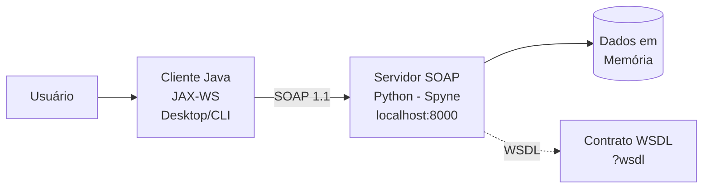

# Eventos SOAP

Serviço Web SOAP para gerenciamento de eventos com servidor Python (Spyne) e cliente Java (JAX-WS).
Demonstra interoperabilidade entre tecnologias distintas utilizando o protocolo SOAP 1.1.

## Requisitos

| Requisito | Implementação |
| --- | --- |
| Servidor SOAP | Python com Spyne em `server`, porta `8000` |
| Contrato WSDL | Funcional e acessível em `http://localhost:8000/?wsdl` |
| Operações | 4 - CRUD completo |
| Cliente consumidor | Java com JAX-WS em `client` |
| Testes | SoapUI integrado e validações de requisições |
| Validação | Tratamento de erros via SOAP Fault |

## Arquitetura



- **Servidor**: Publicação via WSGI, validação XML contra XSD, suporte a SOAP Fault.
- **Cliente**: Interface interativa no terminal, consumo via JAX-WS com WSDL.
- **Comunicação**: SOAP 1.1 com Envelope, Body e namespaces corretos.
- **Dados**: Simulados em memória com lista (sem persistência).

## Tecnologias

Python 3.12, Spyne, Java 25, JAX-WS, Maven, Docker Compose, XML/XSD, SOAP 1.1.

## Execução

### Pré-requisitos

Docker, ou:
- Python 3.12+ e pip
- Java 11+ com Maven

### Backend

**Opção 1: Com Docker Compose (recomendado)**

```bash
docker-compose up --build
```

O servidor estará em `http://localhost:8000` e o cliente rodará interativamente.

**Opção 2: Localmente (sem Docker)**

Terminal 1 - Servidor:
```bash
cd server
pip install -r requirements.txt
python server_soap.py
```

Terminal 2 - Cliente:
```bash
cd client
mvn clean package
java -cp "target/client-1.0-SNAPSHOT.jar:target/lib/*" br.com.estudo.Main
```

### Encerrar

```bash
docker-compose down
```

## APIs SOAP

### Operações

| Operação | Entrada | Saída | Falha |
| --- | --- | --- | --- |
| CriarEvento | titulo, data, local, categoria, qtdConvidados | id, titlo, data, local, categoria, qtdConvidados | - |
| ListarEventos | - | array de Evento | - |
| AtualizarEvento | id, titulo, data, local, categoria, qtdConvidados | Evento atualizado | ID não encontrado |
| DeletarEvento | id | boolean (sucesso) | SOAP Fault se ID não existe |

## Testes

### Cliente Interativo

Execute o cliente Java para uma interface menu-driven:

```bash
java -cp "target/client-1.0-SNAPSHOT.jar:target/lib/*" br.com.estudo.Main
```

Opções disponíveis:
1. Criar evento
2. Listar eventos
3. Atualizar evento
4. Deletar evento
5. Sair

### SoapUI

Importe o WSDL em `http://localhost:8000/?wsdl` no SoapUI para:
- Validar requests e responses
- Testar cada operação
- Gerar documentação automática
- Validar SOAP Faults

### Validação de Erros

Tente deletar um evento com ID inválido:

```xml
<tns:DeletarEvento>
  <tns:id>999</tns:id>
</tns:DeletarEvento>
```

A resposta conterá um `soap:Fault` com mensagem de erro.

## Estrutura do Repositório

```
eventos-soap/
├── server/
│   ├── Dockerfile
│   ├── requirements.txt
│   ├── server_soap.py                         # Servidor principal
│   └── wsdl/
│       └── eventos.wsdl                       # Contrato WSDL
├── client/
│   ├── Dockerfile
│   ├── pom.xml
│   ├── src/main/java/br/com/estudo/Main.java  # Cliente Java
│   └── src/main/resources/wsdl/ 
├── docker-compose.yml
├── README.md